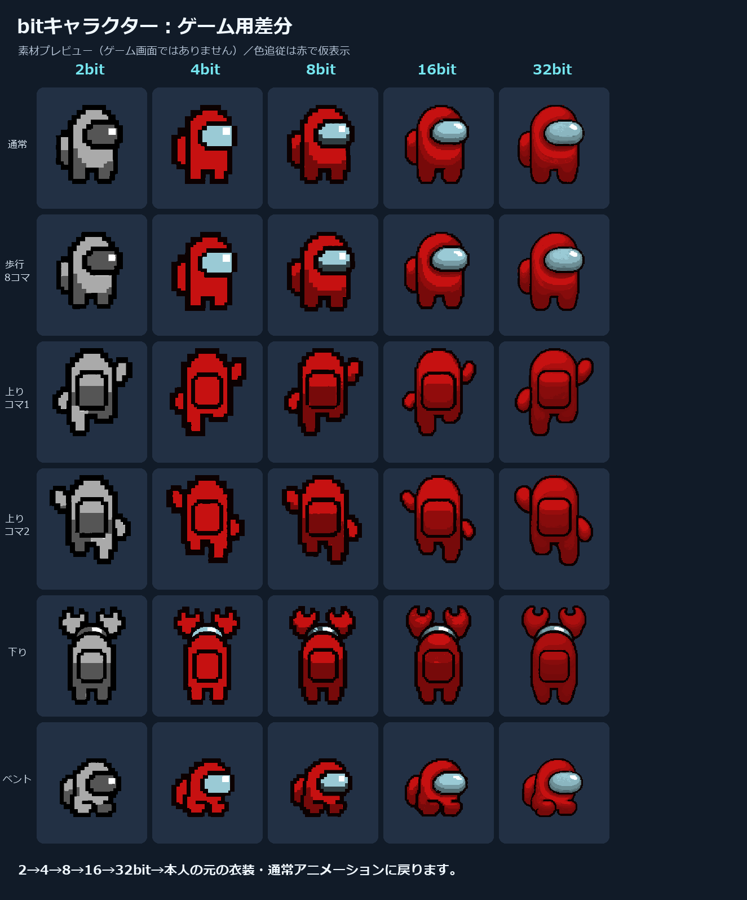

# bitキャラクター（β20）

モディファイア役職。2 → 4 → 8 → 16 → 32 → 64 → 元の姿の順に見た目と声が進化する。64bitは滑らかな専用画像・音声の独立した段階で、64bitの継続時間が終わった後に、その人の現在の衣装・通常アニメーション・通常音声へ復帰する。

2〜64bitの6段階それぞれの継続時間をロビーで個別設定できる。範囲は5〜180秒、5秒刻み、初期値は各30秒。会議・追放演出・イントロ・死亡・切断中は進行を止める。会議中は姿の段階を維持して、聞こえる声だけ通常に戻す。

## 素材と表示

- 6段階それぞれに通常、歩行8コマ、はしご上り2コマ、下り専用1枚、ベント姿勢を用意。上りは左右の手足を入れ替える連続フレームとしてNoSのアニメーション時間に同期して交互に再生する。下りはNoS資料の両手を頭上へ上げる専用ポーズで、上りの画像を流用しない。左右反転はNoSに任せる。ベントの出入りは同じ専用姿勢を使う。
- 通常・下り・ベントは300×375px、上りは600×375px、歩行は2400×375px。`Climb`と`ClimbDown`は別ファイル。MoreCosmicの非公開ハットとして登録し、プレイヤー本体・元のスキン・バイザーを一時的に隠す。
- 2bitは4階調グレー、4bit以降はNoSのAdaptive RGBマスクでクルーカラーに追従する。32bitまではPointフィルターと二値アルファを使う。64bitは滑らかな曲線・色の階調・半透明の縁を保持し、Bilinearフィルターを使う。64bitでも衣装優先度は他のbit段階と同じで、ヒーロー変身を上書きしない。
- `Bounce:false`とヘルメット上端の統一で大きなハットの跳ねを抑制し、bitキャラクターだけ歩行8コマと同期した小さな上下動（1周期2歩、衣装ローカルY最大0.07）を加える。ヒーロー衣装の固定原点は維持する。はしご・ベント中は既存のNoSアニメーションへ追従する。
- 元の本体を隠すと消えてしまう足元の影を、衣装の親へ別描画する。歩行の上下動では影を動かさず、NoSの本体の透明度・カメラレイヤー・ソート設定に追従する。はしご、ベント出入り・滞在、死亡、非表示、ヒーロー衣装優先時は消し、段階終了時に破棄する。影用の小さなテクスチャは6段階・全プレイヤーで共有する。
- スーパーヒーロー／イーヴィルヒーローの変身衣装が優先。変身解除後はその時点のbit段階へ戻り、最後の衣装所有者を解除した時だけ元の衣装・描画フラグ・同期ノードを復元する。
- 会議のプレート内にも同段階の姿を適用する。匿名表示の別カラーのプレートは維持する。

素材プレビュー（ゲーム画面ではない）：

[2〜64bit＋元の姿の比較表](design/bit-character/stages-comparison.png)。「元の姿」はNoS標準の無装飾の例で、実際は本人の衣装を復元する。再出力は`python scripts/preview-bit-character.py --table-only`。

[歩行プレビューGIF](design/bit-character/walk-preview.gif) / [画像生成プロンプト](design/bit-character/prompts.json)

[はしご上りプレビューGIF（2コマ交互）](design/bit-character/climb-up-preview.gif)

[はしご下りプレビューGIF（両手を上げる専用姿勢）](design/bit-character/climb-down-preview.gif)

当初の生成指示では原本シートの2つ目のはしごコマを下りと誤記していたが、実際の絵は上りの交互ポーズだったため、現在は上りコマ2として使用する。下りはNoSの`hero-costumes-v2/reference/climb-down.png`を参照して別途補完した。下りの原本は`source/climb-down-stages.png`、組み込み画像生成の指示は[descent-prompt.json](design/bit-character/descent-prompt.json)に保存している。過去の生成指示は制作記録として保持する。

生成モードは組み込み`image_gen`。原本は`docs/design/bit-character/source/`、最終ゲーム用PNGは`addon/MoreCosmic/hats/`、役職アイコンは`addon/Resources/BitCharacter/Icon.png`。bit表記は演出名で、PNGや音声ファイルの実ビット深度の指定ではない。

64bitの原本は`source/64bit.png`。4列×4行の0〜7番に歩行、8番に通常、9〜10番に上り、11番にベント、12番に下り専用姿勢を収録し、13〜15番は空欄。[64bitの生成指示](design/bit-character/64bit-prompt.json)。

再出力：`pwsh -File scripts/export-bit-character.ps1`。配置・透過・歩行差分検証とプレビュー生成：`python scripts/preview-bit-character.py`。

## ベタクル連動

既存の統合AddonLinkに省略可能な`bits`チャンネルを追加。行は`{playerId,stage}`（stage 0〜5が2〜64bit、stage 6が元の姿）。旧アドオンのプロファイルは引き続き受信できる。PID・セッション・タイムスタンプ・重複プレイヤーの検証を維持し、プレイヤーごとに独立して加工する。

PC通常版／Lite共有コード、Web・モバイル版、.NET版へ実装した。自分で聞く他者のライブ音声に、段階別のサンプル保持・量子化を適用する。対象サンプルレートは4/6/8/16/32/44.1kHz。64bitは高精度な量子化で最も鮮明な専用段階とし、その後に加工を完全解除する。声が小さくても聞き取りやすさを保つ圧縮量子化を使う。会議・死亡・切断・最終段階では解除する。録音・音声認識の入力は従来の元音声を維持し、外部サーバーは使わない。

音声演出には通常版・Lite版3.2.66以降、Tauri版3.2.66-tauri-beta.1以降、.NET版3.2.66-net-beta.1以降、Web・モバイル版3.63以降が必要。ホストも対応版を使用する。

## 開発と配布

既存の最新版作業場所とビルドキャッシュ・共有依存を再利用し、未コミット変更を維持して実装した。ソース一式・依存・音声モデルの作業用複製は増やしていない。

## 確認結果（2026-11-17）

2026-11-18のβ21修正：歩行上下動と足元の影を追加。全6段階の2歩分の上下動、地面に固定した影、透明化・はしご・ベント・死亡・描画無効時の非表示、ヒーロー優先と解除、影の破棄を実コードの自動テストで確認。NoS参照アセンブリのコンパイルを通過。起動中のゲームへの差し替えと画面確認は未実施。

- NoS実機参照アセンブリで100スクリプトをコンパイル：エラー・警告0。
- タイマーの境界、複数段階遷移、会議等の停止、複数人の状態分離、衣装の優先順位・解除・元の描画状態の復元：自動テスト通過。
- 素材6段階、既存ヒーロー定義の保持、8コマが別画像、歩行の頭頂位置、上り2コマと下り専用画像の分離、64bitの滑らかなアルファ、全画像のサイズ・透過・はみ出し：検証通過。
- PC・Web／モバイルの型検査、lint、ビルド。.NETクライアントのビルド：通過。Webビルドは既存のCommonJS・Browserslist警告あり。
- 合成PCMで6段階の音質改善、微小音声・無音・分割バッファの連続性、PC／モバイル／.NET一致、実際のバンドル済みAudioWorklet実行：通過。
- PC／Webのproduction成果物から音声カーネルとWorkletコードを抽出し、外部ヘルパーのない隔離環境でPCM加工・通常音声への解除を実行：通過。
- 実際のAddonLink TCPサーバー2個でPC／.NETの新チャンネルと旧版互換を確認。Web／モバイルへの状態転送も確認。
- 既存の役職・ヒーロー衣装音声・アドオン未導入時の処理・クローン／オウム／耳の関連テスト：通過。
- TS/JS全体・変更C#の制御ネストは上限3以内。

実際のNoS画面での歩行・はしご・会議プレート表示、物理マイクを通した聞こえ方は未確認。ゲームへの手動差し替え・再起動は行っていない。配布版はアドオンβ20、PC通常／Lite3.2.66、Tauri3.2.66-tauri-beta.1、Web／モバイル3.63、.NET3.2.66-net-beta.1。
